<p align="center">
  
</p>

<p align="center">
  <a href="https://github.com/ishandutta2007/Awesome-Awesome-Awesome"></a>
  <a href="https://discord.gg/jc4xtF58Ve"></a>
  <a href="https://github.com/ishandutta2007/Awesome-Reverse-Engineering/stargazers"></a>
  <a href="https://github.com/ishandutta2007/Awesome-Reverse-Engineering/network/members"></a>
  <a href="https://github.com/ishandutta2007/Awesome-Reverse-Engineering/blob/main/LICENSE"></a>
  <a href="https://github.com/ishandutta2007/Awesome-Reverse-Engineering/commits/main"></a>
  <a href="https://github.com/ishandutta2007/Awesome-Reverse-Engineering/pulls"></a>
  <a href="https://github.com/ishandutta2007"></a>
</p>

# ⚡ Awesome Reverse Engineering & Binary Analysis

> **Curated, production-grade guide to reverse engineering platforms, interactive disassemblers, multi-architecture decompilers, dynamic instrumentation frameworks, symbolic execution engines, and cloud malware analysis sandboxes.**

[](https://awesome.re)
[](https://github.com/ishandutta2007/Awesome-Reverse-Engineering)
[](https://github.com/ishandutta2007/Awesome-Reverse-Engineering)

This repository serves as an authoritative directory for security researchers, malware analysts, vulnerability hunters, embedded firmware engineers, and CTF competitors. Whether you are lifting x86/ARM/MIPS/RISC-V machine code, tracing proprietary network protocols, extracting packed firmware images, or performing automated symbolic concolic execution, this ecosystem maps both commercial SaaS platforms and premier open-source frameworks.

---

## 📑 Table of Contents

- [🌐 Sector Overview & Market Dynamics](#-sector-overview--market-dynamics)
- [💼 Commercial & SaaS Binary Analysis Platforms](#-commercial--saas-binary-analysis-platforms)
- [🔓 Open-Source Reverse Engineering Frameworks](#-open-source-reverse-engineering-frameworks)
  - [⭐ Open-Source Quick Comparison](#-open-source-quick-comparison)
  - [🛠️ Detailed Project Profiles](#️-detailed-project-profiles)
- [🎯 Tool Selection & Architecture Matrix](#-tool-selection--architecture-matrix)
- [🤝 How to Contribute](#-how-to-contribute)
- [⚖️ Legal & Ethical Disclaimer](#️-legal--ethical-disclaimer)

---

## 🌐 Sector Overview & Market Dynamics

The specialized software reverse engineering and binary analysis tooling market is estimated at **USD 1.62 Billion to USD 2.04 Billion in 2026**, with projections surpassing **USD 4.85 Billion by 2032** at a Compound Annual Growth Rate (CAGR) of **11.2%**. Market acceleration is primarily driven by escalating software supply-chain vulnerabilities, zero-day threat intelligence requirements, mandatory firmware SBOM (Software Bill of Materials) audits, and the proliferation of IoT/automotive embedded systems.

From a competitive standpoint, the sector demonstrates **moderate fragmentation with pronounced dual-tier dynamics**:
- **Desktop Disassemblers & Decompilers (High Concentration):** The core static reverse engineering layer has historically functioned as an oligopoly dominated by Hex-Rays (IDA Pro), but has shifted into a resilient triopoly alongside the National Security Agency's open-source release of Ghidra and Vector 35's API-first Binary Ninja. High switching costs and decades of custom plugin scripts create high barriers to entry.
- **Automated Cloud Sandboxes & Binary Intelligence (High Fragmentation):** The SaaS detonation, genetic code analysis, and dynamic instrumentation segment is highly fragmented. Multiple specialized startups and enterprise cybersecurity conglomerates compete vigorously on proprietary ML clustering, behavioral heuristic models, API integration speed, and live kernel emulation fidelity.

---

## 💼 Commercial & SaaS Binary Analysis Platforms

The table below ranks the leading commercial and SaaS reverse engineering platforms, **sorted descending by company scale (valuation / annual revenue)**. All pricing tiers and free access thresholds are verified.

| Platform / Tool | Vendor / Developer | Company Scale (Valuation / Revenue) 🔻 | Starting Tier Pricing | Free Tier / Trial Limits | Primary Capabilities & Architectural Scope |
| :--- | :--- | :--- | :--- | :--- | :--- |
| **[VirusTotal Enterprise](https://www.virustotal.com/)** | Google LLC / Alphabet Inc. | **Valuation: ~$2.10T**<br>Revenue: ~$350B | **$10,000 / year**<br>($833/mo for Enterprise API Starter Tier) | **Free Forever**: Public Web & Public API plan with 500 requests/day, 4 requests/min rate limit, 32 MB max file size, public community telemetry feed | Cloud-native multi-engine malware triage, binary behavioral detonation, automated static heuristics, and global threat dataset search. |
| **[Intezer Analyze](https://www.intezer.com/)** | Intezer Labs Ltd. | **Valuation: ~$150M – $250M**<br>Revenue: ~$15M ARR ($60M Raised) | **$6,000 / year**<br>($500/mo for Team / Automated Triage tier) | **Free Forever**: Community Edition with 50 file uploads/month, 10 endpoint triage scans/month, community analysis feed | Genetic binary code analysis, automated malware triage, memory payload unpacker, and code reuse attribution. |
| **[IDA Pro](https://hex-rays.com/ida-pro)** | Hex-Rays SA (Smartfin) | **Valuation: ~$120M**<br>Revenue: €20M+ (~$22M+) ARR | **$365 / year** (IDA Home, 1 arch)<br>**$1,879 / year** (IDA Pro Standalone Named) | **Free Forever**: IDA Free tier strictly restricted to x86/x64 binaries, non-commercial use only, simplified cloud-based decompiler, no IDAPython plugin scripting; or 30-day Pro evaluation upon manual approval | The long-standing gold standard interactive disassembler and multi-processor decompiler supporting 60+ CPU families. |
| **[ANY.RUN](https://any.run/)** | ANY.RUN LLC | **Valuation: ~$50M – $70M**<br>Revenue: ~$12M ARR | **$1,920 / year**<br>($160/mo billed annually for Hunter Plan) | **Free Forever**: Community Plan with unlimited public sandbox submissions, 60-second runtime limit per task, 16 MB max upload, public reports only | Interactive cloud malware sandbox, real-time binary execution tracing, live memory dump analysis, and MITRE ATT&CK mapping. |
| **[Joe Sandbox Cloud](https://www.joesecurity.org/)** | Joe Security LLC | **Valuation: ~$25M – $35M**<br>Revenue: ~$6M ARR | **$499 / month** ($5,988/yr for Cloud Pro)<br>or **€495 one-time** (Cloud Light, 50 private analyses) | **Free Forever**: Cloud Basic tier with 10 analyses/month, single user, public community reports; or 14-day vendor-assisted evaluation | Deep automated malware & binary analysis sandbox with behavioral graphing across Windows, macOS, Linux, and Android. |
| **[Binary Ninja](https://binary.ninja/)** | Vector 35 Inc. | **Valuation: ~$12M**<br>Revenue: ~$2.5M ARR (Bootstrapped) | **$99** (Student perpetual)<br>**$299** (Personal perpetual with 1-yr updates)<br>**$1,499** (Commercial named license) | **Free Forever**: Binary Ninja Free desktop demo limited to x86/x64, file saving and binary export disabled, limited undo history; Binary Ninja Cloud tier limited to public uploads ≤5 MB | Modern API-first binary analysis platform featuring BNIL intermediate language, multi-architecture decompiler, and native Python/Rust APIs. |
| **[JEB Decompiler](https://www.pnfsoftware.com/)** | PNF Software Inc. | **Valuation: ~$8M**<br>Revenue: ~$1.5M ARR (Bootstrapped) | **€1,080 / year** (~$1,170/yr for JEB Android)<br>**€2,160 / year** (Full Pro Suite) | **Free Forever**: JEB Community Edition limited to Android APK/DEX decompilation and ARM32, 1 file per session, no plugins/Python scripts, watermarked decompilation; or 30-day Pro evaluation upon request | Specialized enterprise modular decompiler for Android/Dalvik, DEX, ARM, MIPS, and WebAssembly with interactive AST refactoring. |
| **[Hopper Disassembler](https://www.hopperapp.com/)** | Cryptic Apps SARL | **Valuation: ~$3M**<br>Revenue: ~$600K ARR (Bootstrapped) | **$99** (Personal perpetual with 1-yr updates)<br>**$229** (Commercial perpetual license) | **Free Forever**: Demo version limited to 30-minute runtime sessions per launch, document saving disabled, export disabled, clipboard copying disabled | Native macOS and Linux interactive disassembler and decompiler for Mach-O, ELF, and PE binaries with GDB/LLDB integration. |

---

## 🔓 Open-Source Reverse Engineering Frameworks

The open-source reverse engineering ecosystem is expansive, covering disassemblers, decompilers, kernel debuggers, CPU emulators, and symbolic analysis engines.

### ⭐ Open-Source Quick Comparison

Repos are **sorted descending by GitHub star counts**. Each social star badge links directly to that repository's stargazers page.

| # | Project | GitHub Stars | Category | Core Architecture Support | License |
| :---: | :--- | :---: | :--- | :--- | :---: |
| 1 | **[Ghidra](https://github.com/NationalSecurityAgency/ghidra)** | <a href="https://github.com/NationalSecurityAgency/ghidra/stargazers"></a> | Complete RE Suite & Decompiler | x86, ARM, MIPS, PowerPC, RISC-V, 68HC, + | Apache-2.0 |
| 2 | **[JADX](https://github.com/skylot/jadx)** | <a href="https://github.com/skylot/jadx/stargazers"></a> | Dex to Java Decompiler | Android DEX, APK, AAB, JAR, CLASS | Apache-2.0 |
| 3 | **[x64dbg](https://github.com/x64dbg/x64dbg)** | <a href="https://github.com/x64dbg/x64dbg/stargazers"></a> | Ring-3 User-Mode Debugger | Windows x86 & x64 PE | GPL-3.0 |
| 4 | **[ILSpy](https://github.com/icsharpcode/ILSpy)** | <a href="https://github.com/icsharpcode/ILSpy/stargazers"></a> | .NET Assembly Decompiler | .NET Framework, .NET Core, C# IL | MIT |
| 5 | **[Radare2](https://github.com/radareorg/radare2)** | <a href="https://github.com/radareorg/radare2/stargazers"></a> | Scriptable CLI RE Framework | x86, ARM, MIPS, AVR, SPARC, WebAssembly, + | LGPL-3.0 |
| 6 | **[Frida](https://github.com/frida/frida)** | <a href="https://github.com/frida/frida/stargazers"></a> | Dynamic Binary Instrumentation | Windows, macOS, Linux, iOS, Android, QNX | wxWindows |
| 7 | **[Cutter](https://github.com/rizinorg/cutter)** | <a href="https://github.com/rizinorg/cutter/stargazers"></a> | GUI for Rizin / Radare2 Engine | Multi-architecture via Rizin core | GPL-3.0 |
| 8 | **[Binwalk](https://github.com/ReFirmLabs/binwalk)** | <a href="https://github.com/ReFirmLabs/binwalk/stargazers"></a> | Firmware Extraction & Analysis | Embedded filesystems, ROMs, Flash blobs | MIT |
| 9 | **[Detect It Easy](https://github.com/horsicq/Detect-It-Easy)** | <a href="https://github.com/horsicq/Detect-It-Easy/stargazers"></a> | Packer & Compiler Identifier | PE, ELF, Mach-O, APK, DEX, Binary | MIT |
| 10 | **[dnSpyEx](https://github.com/dnSpyEx/dnSpy)** | <a href="https://github.com/dnSpyEx/dnSpy/stargazers"></a> | .NET Debugger & Assembly Editor | .NET assemblies, Unity, C# IL | GPL-3.0 |
| 11 | **[Pwndbg](https://github.com/pwndbg/pwndbg)** | <a href="https://github.com/pwndbg/pwndbg/stargazers"></a> | Exploit & Reversing GDB Plugin | x86, x64, ARM, AArch64, MIPS | MIT |
| 12 | **[YARA](https://github.com/VirusTotal/yara)** | <a href="https://github.com/VirusTotal/yara/stargazers"></a> | Pattern Matching Rule Engine | Binary files, Memory buffers, Raw data | BSD-3-Clause |
| 13 | **[Unicorn Engine](https://github.com/unicorn-engine/unicorn)** | <a href="https://github.com/unicorn-engine/unicorn/stargazers"></a> | CPU Emulator Framework | x86, ARM, ARM64, MIPS, SPARC, RISC-V | GPL-2.0 |
| 14 | **[Angr](https://github.com/angr/angr)** | <a href="https://github.com/angr/angr/stargazers"></a> | Symbolic Execution & Binary Analysis | Multi-architecture via VEX IR | BSD-2-Clause |
| 15 | **[Capstone Engine](https://github.com/capstone-engine/capstone)** | <a href="https://github.com/capstone-engine/capstone/stargazers"></a> | Disassembly Framework Library | x86, ARM, ARM64, MIPS, PPC, RISC-V | BSD-3-Clause |
| 16 | **[RetDec](https://github.com/avast/retdec)** | <a href="https://github.com/avast/retdec/stargazers"></a> | LLVM-Based Machine Code Decompiler | PE, ELF, Raw (x86, ARM, MIPS, PIC32) | MIT |
| 17 | **[GEF](https://github.com/hugsy/gef)** | <a href="https://github.com/hugsy/gef/stargazers"></a> | GDB Enhanced Features for Reversing | x86, ARM, MIPS, PowerPC, SPARC | MIT |
| 18 | **[Capa](https://github.com/mandiant/capa)** | <a href="https://github.com/mandiant/capa/stargazers"></a> | Automated Capability Identifier | PE, ELF, .NET, Raw Shellcode | Apache-2.0 |
| 19 | **[Cuckoo Sandbox](https://github.com/cuckoosandbox/cuckoo)** | <a href="https://github.com/cuckoosandbox/cuckoo/stargazers"></a> | Automated Malware Detonation System | Windows, Linux, macOS, Android guest VMs | GPL-3.0 |
| 20 | **[Kaitai Struct](https://github.com/kaitai-io/kaitai_struct)** | <a href="https://github.com/kaitai-io/kaitai_struct/stargazers"></a> | Declarative Binary Parser Generator | Multi-language code generation | GPL-3.0 / MIT |
| 21 | **[Triton](https://github.com/JonathanSalwan/Triton)** | <a href="https://github.com/JonathanSalwan/Triton/stargazers"></a> | Dynamic Binary Analysis & DSE | x86, x64, ARM32, AArch64 | Apache-2.0 |
| 22 | **[FLARE-FLOSS](https://github.com/mandiant/flare-floss)** | <a href="https://github.com/mandiant/flare-floss/stargazers"></a> | Obfuscated String Deobfuscator | PE, ELF binaries | Apache-2.0 |
| 23 | **[Rizin](https://github.com/rizinorg/rizin)** | <a href="https://github.com/rizinorg/rizin/stargazers"></a> | Modular UNIX-like RE Framework | Multi-architecture via tree-sitter & RzIL | LGPL-3.0 |
| 24 | **[PE-bear](https://github.com/hasherezade/pe-bear)** | <a href="https://github.com/hasherezade/pe-bear/stargazers"></a> | Portable Executable (PE) Reversing GUI | Windows PE32 and PE64 binaries | GPL-2.0 |
| 25 | **[Keystone Engine](https://github.com/keystone-engine/keystone)** | <a href="https://github.com/keystone-engine/keystone/stargazers"></a> | Multi-Architecture Assembler Engine | x86, ARM, ARM64, MIPS, PPC, SPARC | GPL-2.0 |

---

### 🛠️ Detailed Project Profiles

#### 1. [Ghidra](https://github.com/NationalSecurityAgency/ghidra) <a href="https://github.com/NationalSecurityAgency/ghidra/stargazers"></a>
- **Description**: Developed by the National Security Agency (NSA), Ghidra is a comprehensive, enterprise-ready software reverse engineering suite. It includes a multi-target disassembler, interactive graphical decompiler, scriptable headless analysis engine, and multi-user collaborative repository server.
- **Key Strengths**: Unmatched out-of-the-box decompiler fidelity across diverse architectures (ARM, MIPS, RISC-V, x86/x64); robust tolerance for malformed and packed binaries; Java and Python (Jython/PyGhidra) scripting APIs.
- **License**: Apache-2.0 | **Primary Language**: Java

#### 2. [JADX](https://github.com/skylot/jadx) <a href="https://github.com/skylot/jadx/stargazers"></a>
- **Description**: The definitive open-source DEX-to-Java decompiler for Android application auditing and malware analysis. Includes both a command-line utility and an intuitive Qt/Swing GUI with instant deobfuscation and search.
- **Key Strengths**: Directly parses APK, DEX, AAB, JAR, and CLASS files; restores Android resources (`AndroidManifest.xml`, layout XMLs); integrated deobfuscator with renaming and cross-referencing.
- **License**: Apache-2.0 | **Primary Language**: Java

#### 3. [x64dbg](https://github.com/x64dbg/x64dbg) <a href="https://github.com/x64dbg/x64dbg/stargazers"></a>
- **Description**: An active, open-source ring-3 user-mode debugger for Microsoft Windows targeting malware analysis, executable unpacking, and vulnerability exploitation.
- **Key Strengths**: Modern Qt GUI with customizable color schemes; extensive plugin architecture (Scylla unpacker, TitanEngine); memory map inspection, conditional hardware breakpoints, and graph execution view.
- **License**: GPL-3.0 | **Primary Language**: C++

#### 4. [ILSpy](https://github.com/icsharpcode/ILSpy) <a href="https://github.com/icsharpcode/ILSpy/stargazers"></a>
- **Description**: The open-source .NET assembly browser and decompiler with cross-platform support via Avalonia UI and Visual Studio / VS Code extensions.
- **Key Strengths**: Excellent decompilation quality reproducing modern C# language features (records, pattern matching, async/await, lambdas); saves complete decompiled C# solutions directly to disk.
- **License**: MIT | **Primary Language**: C#

#### 5. [Radare2](https://github.com/radareorg/radare2) <a href="https://github.com/radareorg/radare2/stargazers"></a>
- **Description**: A UNIX-philosophy command-line framework for binary analysis, disassembly, debugging, and binary diffing (`radiff2`). Designed from the ground up for shell automation and pipelining.
- **Key Strengths**: Exceptional portability running on embedded systems, Linux, macOS, and Windows; scriptable in Python, Go, Rust, and JavaScript via `r2pipe`; supports hundreds of file formats and CPU instruction sets.
- **License**: LGPL-3.0 | **Primary Language**: C

#### 6. [Frida](https://github.com/frida/frida) <a href="https://github.com/frida/frida/stargazers"></a>
- **Description**: A dynamic code instrumentation toolkit that lets you inject JavaScript snippets or native libraries into running processes across Windows, macOS, Linux, iOS, and Android.
- **Key Strengths**: Hook arbitrary cryptographic APIs, bypass SSL/TLS certificate pinning, trace function arguments at runtime, and modify return values on the fly without patching binaries on disk.
- **License**: wxWindows | **Primary Language**: C / JavaScript / Python

#### 7. [Cutter](https://github.com/rizinorg/cutter) <a href="https://github.com/rizinorg/cutter/stargazers"></a>
- **Description**: The official graphical user interface for Rizin (the community fork of Radare2). Built with C++ and Qt, it brings a sleek visual interface to command-line binary reversing.
- **Key Strengths**: Native integration with the Ghidra decompiler plugin (`rz-ghidra`); interactive call graph views; memory visualization; integrated Python scripting console and breakpoint management.
- **License**: GPL-3.0 | **Primary Language**: C++ / Qt

#### 8. [Binwalk](https://github.com/ReFirmLabs/binwalk) <a href="https://github.com/ReFirmLabs/binwalk/stargazers"></a>
- **Description**: The industry-standard tool for searching raw binary firmware images for embedded file types, compressed archives (SquashFS, CramFS, JFFS2), bootloader headers (U-Boot), and cryptographic signatures.
- **Key Strengths**: Automated recursive extraction (`binwalk -e`); entropy analysis graphing (`binwalk -E`) to distinguish uncompressed code, encrypted payloads, and compressed partitions.
- **License**: MIT | **Primary Language**: Python

#### 9. [Detect It Easy (DIE)](https://github.com/horsicq/Detect-It-Easy) <a href="https://github.com/horsicq/Detect-It-Easy/stargazers"></a>
- **Description**: A cross-platform binary signature inspection program for identifying file architectures, packers (UPX, Themida, VMProtect), compilers, linkers, and protectors.
- **Key Strengths**: Open signature scripting system in JavaScript; fast file entropy visualization; integrated hex viewer and PE/ELF header parser; available as GUI, CLI, and standalone SDK.
- **License**: MIT | **Primary Language**: C++ / Qt

#### 10. [dnSpyEx](https://github.com/dnSpyEx/dnSpy) <a href="https://github.com/dnSpyEx/dnSpy/stargazers"></a>
- **Description**: The community-maintained fork of dnSpy, providing an all-in-one .NET assembly editor, decompiler, and interactive debugger.
- **Key Strengths**: Edit .NET assemblies directly in high-level C# or intermediate language (IL) without source code; attach and debug obfuscated .NET malware and Unity game binaries in real time.
- **License**: GPL-3.0 | **Primary Language**: C#

#### 11. [Pwndbg](https://github.com/pwndbg/pwndbg) <a href="https://github.com/pwndbg/pwndbg/stargazers"></a>
- **Description**: A Python module loaded directly into GDB, revolutionizing Linux binary exploitation, vulnerability analysis, and reverse engineering workflows.
- **Key Strengths**: Rich context display showing CPU registers, stack contents, disassembly, and memory dereference chains; advanced heap visualization commands (`heap`, `bins`, `vis_heap_chunks`) for glibc heap exploitation.
- **License**: MIT | **Primary Language**: Python

#### 12. [YARA](https://github.com/VirusTotal/yara) <a href="https://github.com/VirusTotal/yara/stargazers"></a>
- **Description**: The pattern matching swiss-army knife for malware researchers. Enables classification and detection of threat families based on textual, hexadecimal, and regular expression patterns.
- **Key Strengths**: Industry standard format for cyber threat intelligence (CTI); modular extensions for parsing PE, ELF, Mach-O, and dotnet structures; integrated into every major SOC and EDR platform.
- **License**: BSD-3-Clause | **Primary Language**: C

#### 13. [Unicorn Engine](https://github.com/unicorn-engine/unicorn) <a href="https://github.com/unicorn-engine/unicorn/stargazers"></a>
- **Description**: A lightweight, multi-architecture CPU emulator framework based on QEMU, optimized specifically for reverse engineering, binary instrumentation, and malware unpacking.
- **Key Strengths**: Emulates isolated basic blocks or functions across ARM, ARM64, MIPS, x86, PowerPC, and SPARC without booting a complete OS; native bindings for Python, Rust, Go, Java, and C.
- **License**: GPL-2.0 | **Primary Language**: C

#### 14. [Angr](https://github.com/angr/angr) <a href="https://github.com/angr/angr/stargazers"></a>
- **Description**: A Python binary analysis suite combining static analysis (CFG recovery, value-set analysis) with dynamic symbolic execution (concolic execution) via the Z3 SMT solver.
- **Key Strengths**: Automated state exploration to find inputs that trigger specific program branches; automatic vulnerability discovery and exploit generation; lifted to LibVEX intermediate representation.
- **License**: BSD-2-Clause | **Primary Language**: Python

#### 15. [Capstone Engine](https://github.com/capstone-engine/capstone) <a href="https://github.com/capstone-engine/capstone/stargazers"></a>
- **Description**: The ultimate lightweight disassembly framework for binary analysis engines, security tools, and virtual machine monitors.
- **Key Strengths**: High-performance multi-platform disassembly supporting ARM, ARM64, x86, x64, MIPS, PowerPC, SPARC, SystemZ, and RISC-V; decomposes instructions into semantic details (registers read/written, operands, groups).
- **License**: BSD-3-Clause | **Primary Language**: C

#### 16. [RetDec](https://github.com/avast/retdec) <a href="https://github.com/avast/retdec/stargazers"></a>
- **Description**: A retargetable machine-code decompiler developed by Avast, leveraging LLVM to lift native compiled binaries into clean, compilable C-like pseudocode.
- **Key Strengths**: Decompiles ARM, MIPS, PIC32, PowerPC, and x86 binaries into LLVM Intermediate Representation (IR) before emitting high-level C; supports PE, ELF, and raw firmware images.
- **License**: MIT | **Primary Language**: C++

#### 17. [GEF (GDB Enhanced Features)](https://github.com/hugsy/gef) <a href="https://github.com/hugsy/gef/stargazers"></a>
- **Description**: A modern, lightweight Python extension for GNU GDB designed to streamline native reversing and dynamic exploitation without external dependencies.
- **Key Strengths**: Single-file Python setup; visual heap chunks inspector; canary checking; multi-architecture support (x86, ARM, AArch64, MIPS, PowerPC, SPARC); seamless color-coded assembly context.
- **License**: MIT | **Primary Language**: Python

#### 18. [Capa](https://github.com/mandiant/capa) <a href="https://github.com/mandiant/capa/stargazers"></a>
- **Description**: Developed by Mandiant / Google Cloud, Capa detects malicious capabilities and tactical capabilities in executable files automatically.
- **Key Strengths**: Employs open, YAML-based rule sets mapped directly to MITRE ATT&CK techniques; tells you what a binary can do (e.g., "inject code into process", "bypass UAC", "install hook") before manual reversing begins.
- **License**: Apache-2.0 | **Primary Language**: Python

#### 19. [Cuckoo Sandbox](https://github.com/cuckoosandbox/cuckoo) <a href="https://github.com/cuckoosandbox/cuckoo/stargazers"></a>
- **Description**: The classic self-hosted automated malware analysis system. Drops suspicious files into isolated virtual machines and records all API calls, file writes, and network traffic.
- **Key Strengths**: Fully configurable on-premise execution tracing; dumps network PCAPs, dropped payloads, and memory dumps; extensive REST API for automated pipeline ingestion.
- **License**: GPL-3.0 | **Primary Language**: Python

#### 20. [Kaitai Struct](https://github.com/kaitai-io/kaitai_struct) <a href="https://github.com/kaitai-io/kaitai_struct/stargazers"></a>
- **Description**: A declarative domain-specific language (DSL) for describing arbitrary binary data structures and generating parser code across 10+ programming languages.
- **Key Strengths**: Write a `.ksy` YAML specification once, and compile parser libraries for C++, C#, Java, JavaScript, Python, Ruby, Go, and Rust; interactive web visualizer for inspecting file formats.
- **License**: GPL-3.0 / MIT | **Primary Language**: Scala / Multi-language

#### 21. [Triton](https://github.com/JonathanSalwan/Triton) <a href="https://github.com/JonathanSalwan/Triton/stargazers"></a>
- **Description**: A dynamic binary analysis (DBA) framework providing dynamic symbolic execution, taint analysis, and AST representations of x86, x64, and ARM instructions.
- **Key Strengths**: Precise byte-level taint tracking through memory and registers; generates path constraints solved via Z3/Bitwuzla; ideal for defeating binary packers, VM protectors, and opaque predicates.
- **License**: Apache-2.0 | **Primary Language**: C++ / Python

#### 22. [FLARE-FLOSS](https://github.com/mandiant/flare-floss) <a href="https://github.com/mandiant/flare-floss/stargazers"></a>
- **Description**: The FireEye / Mandiant FLARE Obfuscated String Solver automatically extracts obfuscated, encrypted, and stack-allocated strings from compiled binaries.
- **Key Strengths**: Emulates tight decoding loops via Vivisector to extract runtime decrypted strings without running full dynamic analysis; dramatically accelerates initial malware triage.
- **License**: Apache-2.0 | **Primary Language**: Python

#### 23. [Rizin](https://github.com/rizinorg/rizin) <a href="https://github.com/rizinorg/rizin/stargazers"></a>
- **Description**: The community-driven fork of Radare2 focused on code quality, testing consistency, modernized APIs, and native RzIL intermediate representation.
- **Key Strengths**: Clean C codebase with rigorous continuous integration; tree-sitter integration for parsing; fully compatible with Cutter GUI; optimized binary diffing and disassembling.
- **License**: LGPL-3.0 | **Primary Language**: C

#### 24. [PE-bear](https://github.com/hasherezade/pe-bear) <a href="https://github.com/hasherezade/pe-bear/stargazers"></a>
- **Description**: Developed by security researcher hasherezade, PE-bear is a fast, interactive GUI tool for inspecting and repairing PE (Portable Executable) headers, sections, imports, and exports.
- **Key Strengths**: Instant header visualizer; side-by-side PE file comparison; section dump and unmapping tools; handles heavily corrupted, malformed, or hand-crafted malicious PE files.
- **License**: GPL-2.0 | **Primary Language**: C++

#### 25. [Keystone Engine](https://github.com/keystone-engine/keystone) <a href="https://github.com/keystone-engine/keystone/stargazers"></a>
- **Description**: The multi-platform, multi-architecture assembler counterpart to the Capstone engine, built on top of LLVM core libraries.
- **Key Strengths**: Assembles human-readable assembly instructions into raw machine bytecode for x86, ARM, ARM64, MIPS, PowerPC, and SPARC; vital for binary patching, shellcode synthesis, and inline hooking.
- **License**: GPL-2.0 | **Primary Language**: C++

---

## 🎯 Tool Selection & Architecture Matrix

To construct an optimal reverse engineering toolchain based on project requirements and budget, use the taxonomy below:

```
                                  [ Binary / Firmware Artifact ]
                                                │
                 ┌──────────────────────────────┴──────────────────────────────┐
                 ▼                                                             ▼
     [ Static Inspection & Triage ]                                [ Dynamic Tracing & Emulation ]
                 │                                                             │
   ┌─────────────┼─────────────┐                                 ┌─────────────┼─────────────┐
   ▼             ▼             ▼                                 ▼             ▼             ▼
[Packer/Type] [Signatures]  [Decompilation]                  [Interactive]   [Emulation]   [Hooking/API]
 • DIE         • YARA        • Ghidra (Free, All-Arch)        • x64dbg (Win)  • Unicorn     • Frida
 • Binwalk     • Capa        • Binary Ninja (API-first)       • Pwndbg (GDB)  • Angr (DSE)  • QVE
 • PE-bear     • FLOSS       • IDA Pro (Industry Std)         • GEF (GDB)     • Triton      • eBPF
                             • JADX (Android/DEX)
                             • ILSpy / dnSpyEx (.NET)
```

- **Zero-Budget Complete Stack**: NSA **Ghidra** (decompiler) + **Radare2 / Cutter** (CLI/GUI triage) + **x64dbg / Pwndbg** (debugging) + **Frida** (instrumentation) + **Capa** (capabilities).
- **Enterprise Commercial Stack**: **IDA Pro with Hex-Rays Decompiler** + **Binary Ninja** (automated scripting pipelines) + **VirusTotal Enterprise** + **ANY.RUN / Joe Sandbox** (automated detonation).
- **Firmware & Embedded Reversing**: **Binwalk** (partition extraction) + **Ghidra** (SVD peripheral definitions & decompilation) + **Unicorn Engine** (isolated controller emulation).
- **Automated Symbolic Exploit Discovery**: **Angr** (concolic path exploration) + **Triton** (taint tracking) + **Capstone / Keystone** (disassembly & patching).

---

## 🤝 How to Contribute

Contributions from the cybersecurity community are warmly welcomed! To suggest a tool, correct documentation, or update pricing:

1. **Fork the repository** to your GitHub account.
2. **Create a descriptive feature branch**: `git checkout -b feature/add-new-tool`.
3. **Edit `README.md`**: Follow the established tabular structure and profile format.
   - Include: Tool name, official URL, exact starting pricing, precise free tier limits, verified company scale, and supported architectures.
   - For open-source entries: Include the social star badge linking to the repo's stargazers page.
4. **Submit a Pull Request** with a clear explanation of why the tool is significant for reverse engineering.

⭐ **Star this repository** if you find it valuable for your reverse engineering and malware analysis workflow!

---

## ⚖️ Legal & Ethical Disclaimer

- This repository is a **community-curated educational index** and does not constitute an endorsement of any vendor, commercial offering, or project.
- **Ethical Use Requirement**: Reverse engineering software and binary analysis tools should be utilized strictly for legitimate, ethical, and lawful purposes—such as auditing software you own, authorized penetration testing, vulnerability research with responsible disclosure, educational study, and malware defense within applicable jurisdictional laws.
- **Compliance**: Unauthorized disassembly, decompilation, or circumvention of technological protection measures may violate intellectual property statutes, contract agreements, or laws including the **Digital Millennium Copyright Act (DMCA)** in the United States and the **EU Computer Programs Directive (Directive 2009/24/EC)**. Always obtain verified authorization before inspecting proprietary systems.

---

<p align="center">
  <b>Built with ⚡ for malware analysts, security researchers, vulnerability hunters, and CTF competitors.</b><br>
  <sub>Maintained by <a href="https://github.com/ishandutta2007">Ishan Dutta</a> and the global open-source community.</sub>
</p>
